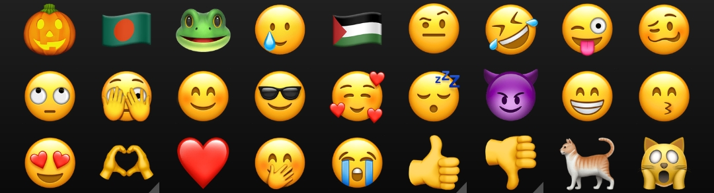
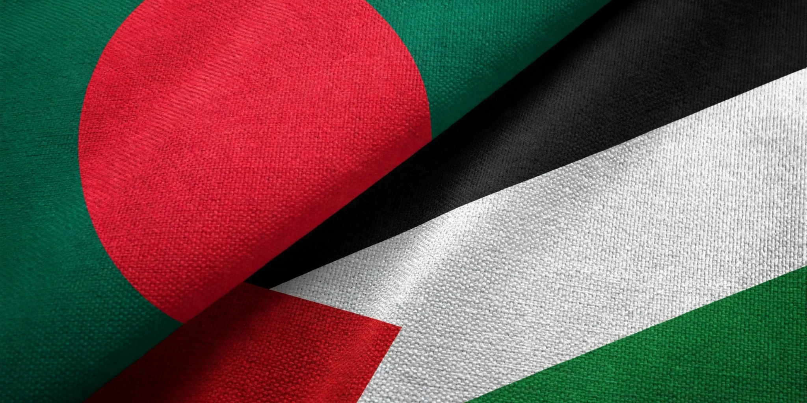

# 🍎 Apple Emoji with ✍️ Kohinoor Bangla Font

**System-wide Apple iOS Emoji + Kohinoor Bangla Font for rooted Android.**

---

## ✨ Features

- 🎨 System-wide Apple iOS Emoji
- 🔤 Kohinoor Bangla Font
- 🚫 No force binding — apps keep their native emoji
- 🎯 Smart fallback — apps using system emoji get Apple emoji
- 🛡️ Override protection — Google can't push stock emoji back
- ⚡ Zero daemon — battery friendly
- 🪶 Ultra lightweight (~30 MB)
- 📱 Android 8 – 16 support
- 🔧 Magisk / KernelSU / APatch ready

---

## 📱 Compatibility

- ✅ Android **8.0 – 16**
- ✅ **Magisk** · **KernelSU** · **KernelSU Next** · **SukiSU** · **ReSukiSU** · **APatch**
- ✅ All mainstream brands (Samsung, Xiaomi, Realme, OPPO, OnePlus, Vivo, Motorola, Nothing, Huawei, Honor, Pixel, Nokia & more)
- ✅ Transsion optimized (XOS · HiOS · itelOS)

---

## ⚠️ Disclaimer

> Educational & personal use only. Use at your own risk.

---

**Made with ❤️ by Sabbir Senpai 😎**

### 🇧🇩 From Bangladesh 🇧🇩
## 🇵🇸 Free Palestine 🇵🇸

 

